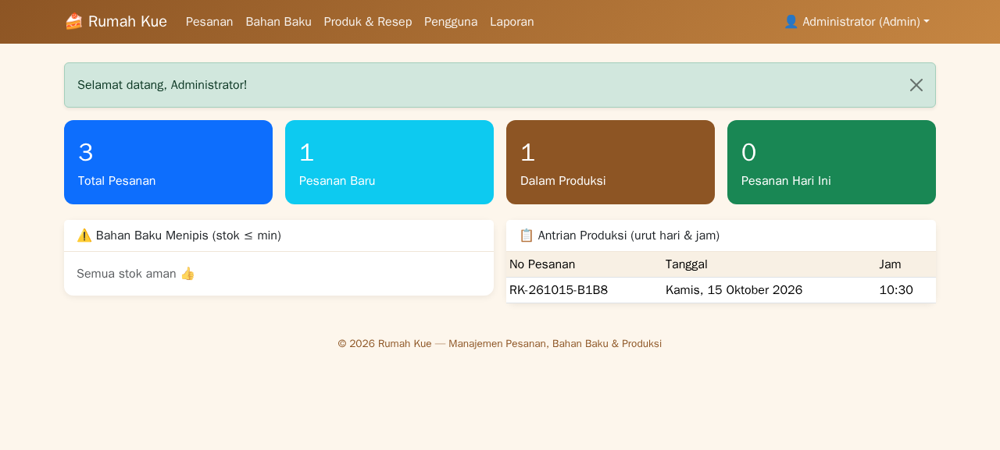
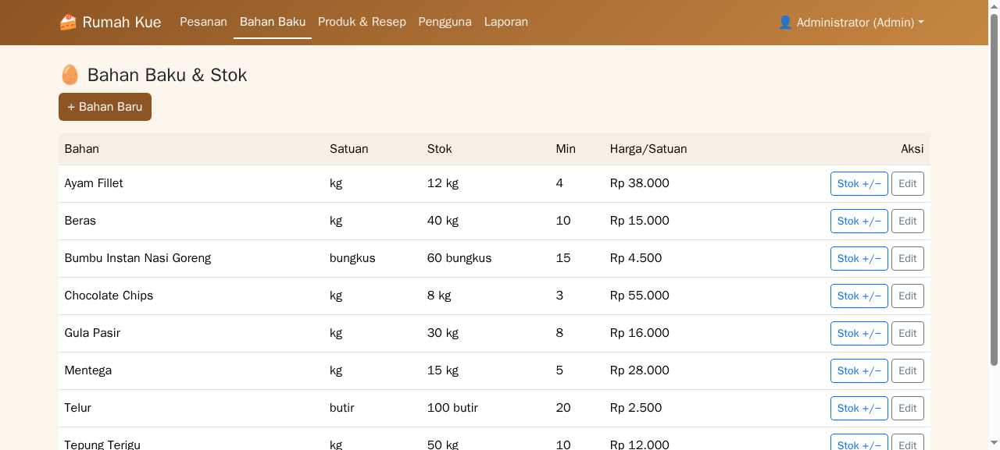
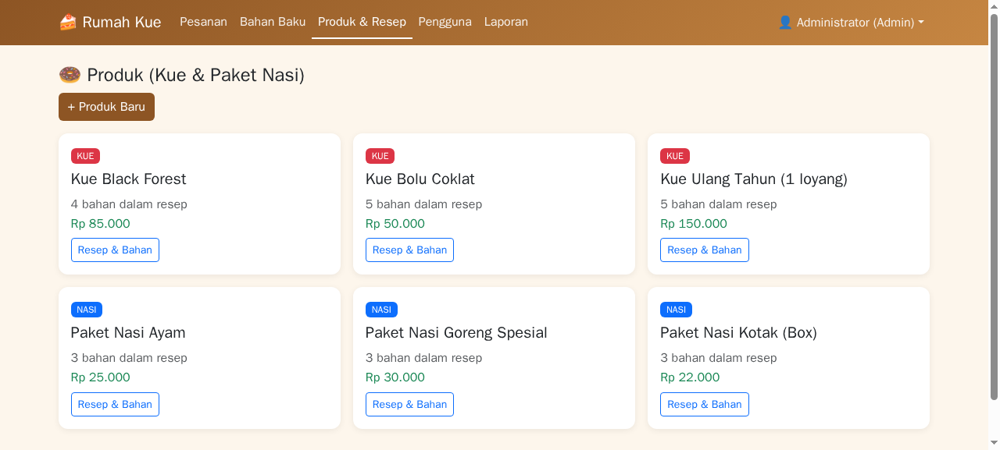
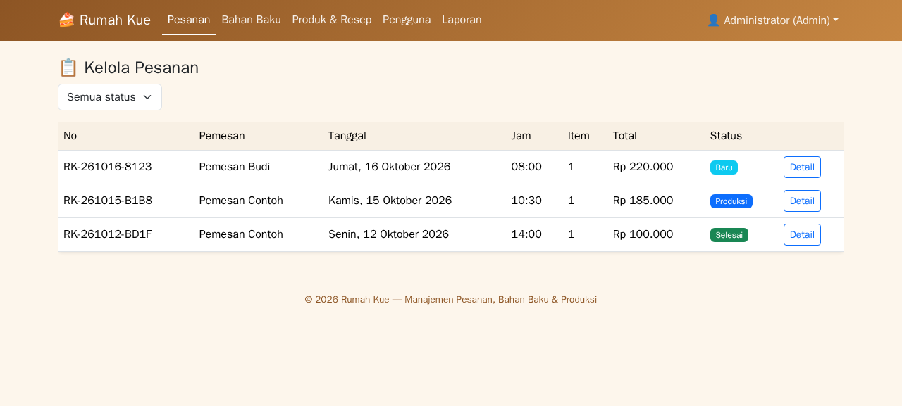
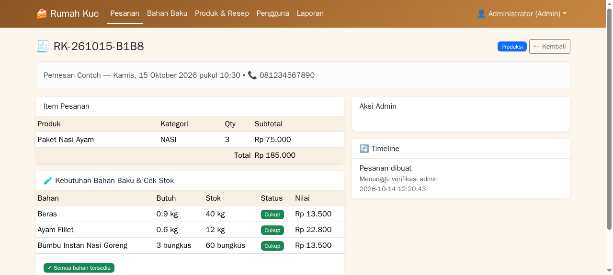
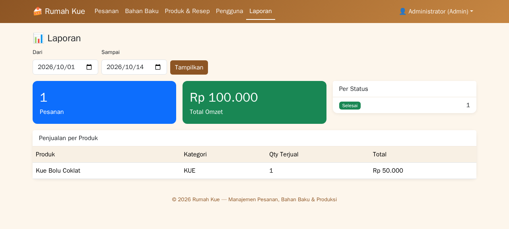
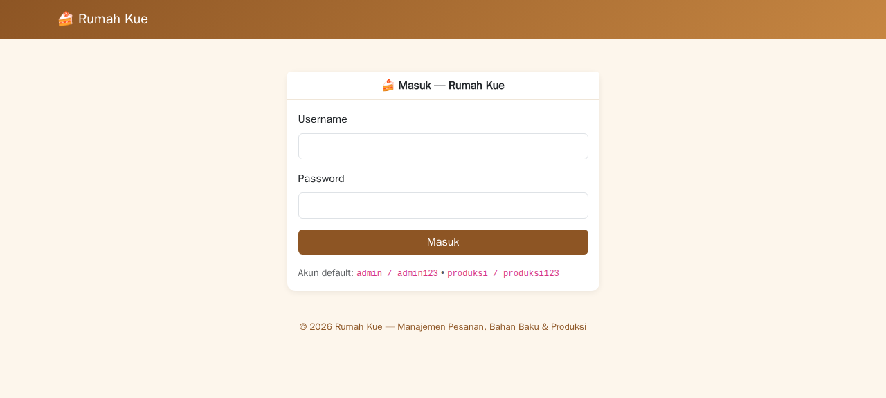
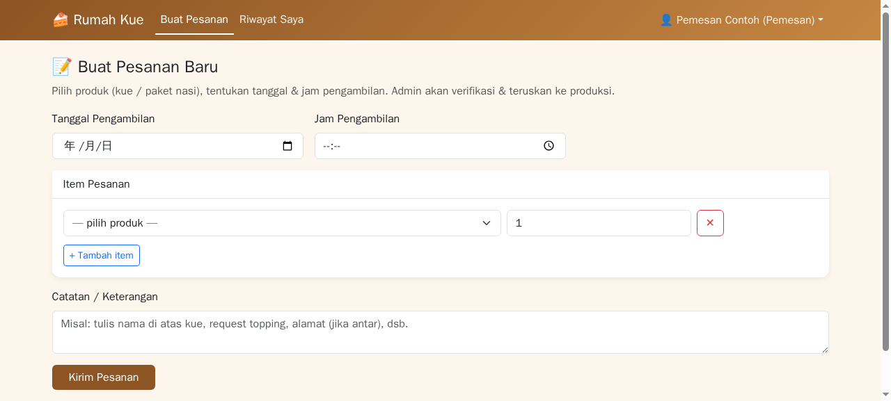
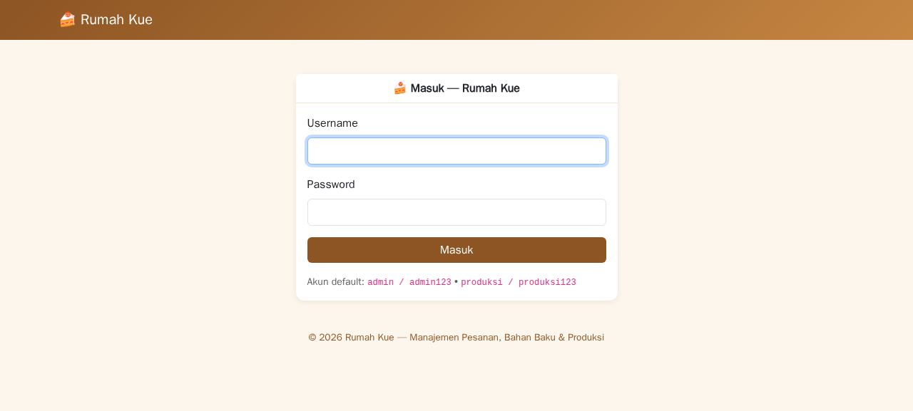

# 🍰 Rumah Kue — Manajemen Pesanan Kue & Paket Nasi

Aplikasi manajemen pesanan untuk rumah produksi **"Rumah Kue"**: dari pemesan → admin → produksi, lengkap dengan detail bahan baku, stok, harga, dan timeline pengerjaan sesuai hari & jam pemesanan.

**Teknologi:** PHP native (tanpa framework) + SQLite • Bootstrap 5 • Tanpa dependensi eksternal

---

## 🖼️ Preview (Screenshot UI)

### 👨‍💼 Admin

| Dashboard | Bahan Baku & Stok | Produk & Resep |
|---|---|---|
|  |  |  |

| Kelola Pesanan | Detail Pesanan (cek bahan & stok) | Laporan |
|---|---|---|
|  |  |  |

### 👨‍🍳 Produksi

| Antrian Produksi (urut hari & jam) |
|---|
|  |

### 🧑‍💼 Pemesan

| Buat Pesanan | Riwayat & Detail |
|---|---|
|  |  |

---

## 🔑 Akun Login (untuk Evaluasi)

| Role | Username | Password | Halaman yang Bisa Diakses |
|---|---|---|---|
| **Admin** | `admin` | `admin123` | Semua (kelola pesanan, bahan baku, produk & resep, pengguna, laporan) |
| **Produksi** | `produksi` | `produksi123` | Antrian produksi, detail pesanan, tandai selesai |
| **Pemesan** | `pemesan` | `pemesan123` | Buat pesanan, riwayat, detail pesanan |

> Akun otomatis dibuat saat aplikasi pertama kali dijalankan (seed di `core/Database.php`). Password bisa diubah lewat DB/php.

---

## 🚀 Cara Menjalankan

### Tanpa Web Server (PHP built-in)
```bash
cd rumah-kue
php -S 127.0.0.1:8898
```
Buka `http://127.0.0.1:8898` dan login dengan salah satu akun di atas.

### Apache / hosting
1. Upload folder `rumah-kue/` ke `public_html/` (atau subfolder).
2. Pastikan PHP ≥ 8.0 dengan ekstensi `pdo_sqlite`.
3. Folder `db/` dibuat otomatis + database `rumahkue.db` otomatis ter-migrasi & ter-seed.
4. `.htaccess` sudah disiapkan untuk routing (Apache mod_rewrite).

---

## 🏗️ Alur Bisnis

```
PEMESAN                ADMIN                    PRODUKSI
   │                      │                        │
   ├─ Buat pesanan        │                        │
   │  (tanggal + jam      │                        │
   │   pengambilan)       │                        │
   │        ─────────────▶│                        │
   │                      ├─ Verifikasi pesanan    │
   │                      ├─ Cek bahan baku & stok │
   │                      │   (resep × qty)        │
   │                      ├─ KURANGI stok otomatis │
   │                      ├─ Catat timeline        │
   │                      │        ───────────────▶│
   │                      │                        ├─ Lihat antrian
   │                      │                        │   (urut hari & jam)
   │                      │                        ├─ Kerjakan sesuai
   │                      │                        │   timeline
   │                      │                        └─ Tandai SELESAI
   │                      │
   │  ┌───────────────────┘
   ▼  ▼
Pantau status di "Riwayat Saya" + timeline lengkap
```

**Status pesanan:** `Baru` → `Verifikasi` → `Produksi` → `Selesai` (atau `Batal`)

---

## 📦 Modul & Fitur

### 1. Pemesan
- **Buat Pesanan** — pilih produk (kue / paket nasi), qty, tanggal & jam pengambilan, catatan
- **Riwayat Saya** — pantau status + timeline lengkap

### 2. Bahan Baku (Admin)
- CRUD bahan: nama, satuan, stok, harga satuan, min stok
- **Mutasi stok**: masuk (beli), keluar (produksi), koreksi — tercatat riwayat
- Peringatan **stok menipis** (stok ≤ min) di dashboard

### 3. Produk & Resep (Admin)
- CRUD produk (KUE / NASI) + harga jual
- Set **resep**: bahan apa saja + qty per produk
- **Estimasi biaya bahan & margin** otomatis (harga jual − biaya resep)

### 4. Kelola Pesanan (Admin)
- Daftar pesanan + filter status, urut prioritas (baru → verifikasi → produksi)
- **Detail pesanan**: item, kebutuhan bahan baku (resep × qty), **cek stok CUKUP/KURANG**, nilai bahan
- **Terima & kirim ke produksi**: stok bahan otomatis dikurangi + mutasi tercatat + timeline
- Tolak dengan alasan (opsional)

### 5. Produksi
- **Timeline pengerjaan** — antrian diurutkan berdasarkan tanggal & jam pengambilan (paling awal dikerjakan duluan)
- Detail pesanan + kebutuhan bahan
- Tandai **Selesai**

### 6. Pengguna (Admin)
- Tambah pengguna: admin / produksi / pemesan + no HP

### 7. Laporan (Admin)
- Filter rentang tanggal: jumlah pesanan, total omzet, penjualan per produk, per status

---

## 📁 Struktur

```
rumah-kue/
├── index.php                  # Front controller / router utama
├── .htaccess                  # Rewrite untuk Apache
├── core/
│   ├── Database.php           # Koneksi SQLite + migrasi + seed akun
│   ├── Auth.php               # Session & autentikasi
│   ├── Controller.php         # Base controller (view, post)
│   ├── Helper.php             # Flash, CSRF, rupiah, label status
│   └── Router.php             # Routing + otorisasi per role
├── controllers/               # Logika per halaman
│   ├── AuthController.php
│   ├── DashboardController.php
│   ├── PesananController.php  # Pemesan buat pesanan
│   ├── BahanController.php    # Bahan baku & stok
│   ├── ProdukController.php   # Produk & resep
│   ├── KelolaController.php   # Admin verifikasi → produksi
│   ├── ProduksiController.php # Antrian & selesai
│   ├── PenggunaController.php
│   └── LaporanController.php
├── views/                     # Template HTML (layout + halaman)
└── db/                        # Database SQLite (otomatis dibuat, di-gitignore)
```

---

## 🛡️ Keamanan
- PDO prepared statement (anti SQL injection)
- `password_hash()` bcrypt (anti hash bocor)
- CSRF token pada semua form POST
- Session regenerate saat login, cookie HttpOnly + SameSite
- Output escaping (`htmlspecialchars`) — anti XSS
- Otorisasi per role di router (pemesan tidak bisa akses halaman admin)

---

## ✅ Status Pengujian
- PHP lint: semua file bersih
- Smoke test: login 3 role (admin/produksi/pemesan) → 200
- Alur lengkap teruji: tambah bahan → tambah produk → set resep → pemesan buat pesanan → admin terima (stok berkurang, mutasi & timeline tercatat) → produksi selesai

© 2026 Rumah Kue